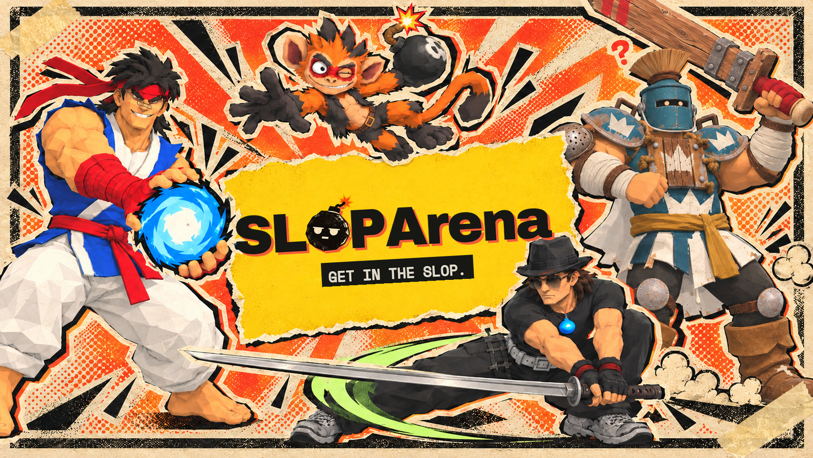
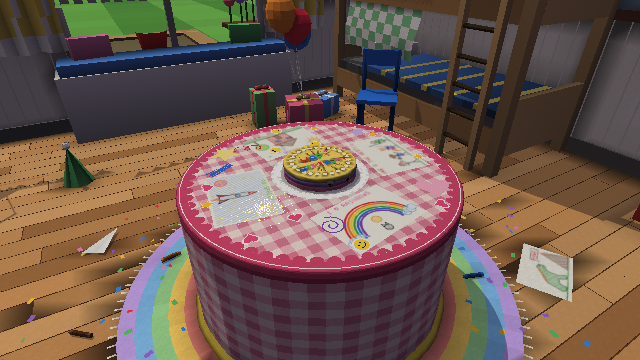
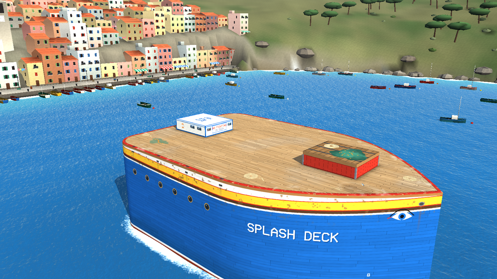
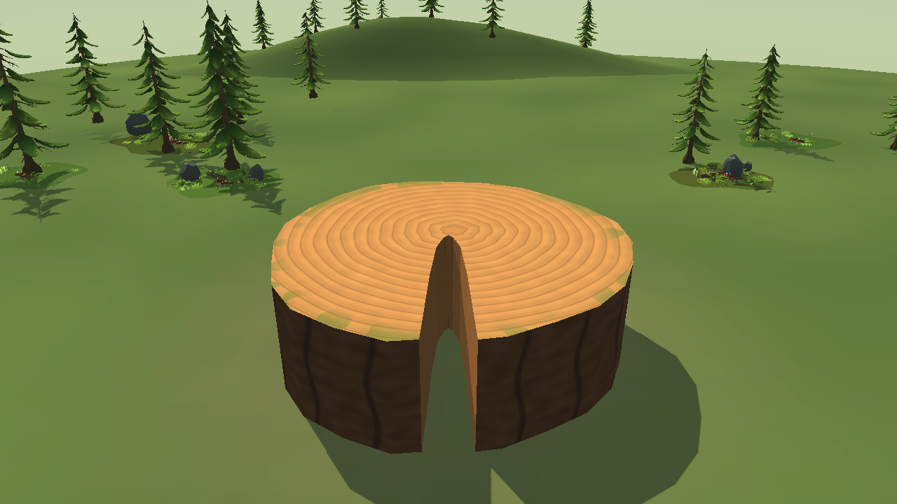

<p align="center">
  
</p>

# SLOPArena

**A free, open-source 3D platform fighter**

[Discord](https://discord.gg/VvfaxDCF6Z) · [Play it](#play-it) · [Try it in five minutes](#try-it-in-five-minutes-no-unity-needed) · [Make stuff](#make-stuff) · [Docs](docs/README.md)

## Hi!

> I'm Binoui, the dev behind SLOPArena. I work as a software engineer and I saw what AI could do first hand. In early 2026, I decided to use it to learn gamedev and make the game i've always wanted to play. I figured if I could create a solid base and make it free and open source, I would be able to find people to burn tokens with me to create the best game ever. Creating SLOPArena has been an amazing experience, full of learnings and discoveries. This repository contains all those experiments, thoughts, decisions and plenty of documentation about the process itself. Oh, and there's also basically the whole game, playable on steam ! If you're curious I suggest browsing it with an agent, they love it in here. Thanks a lot !

<!--
Things friends usually want from this part:
- who you are and why you're making this
- the vibe: what "slop" means here and what you hope the game becomes
- what kind of help or company you're looking for right now
- where to find you
-->

---

<p align="center"><b>— SLOP LINE —</b><br><sub>Everything below this line was drafted with AI.</sub></p>

---

## What is SLOPArena?

It's a platform fighter in the Smash family, in full 3D. Every hit adds damage, and the more damage you carry, the farther you fly, until somebody goes off the stage. Each fighter has a compact kit: eight normal attacks (four on the ground, four in the air) and four specials.

<p align="center">
  
  
  
</p>

- **Five rostered fighters:** FightGuy, Manki, Wibou, Bonk, and Bashie. Bashie's kit still has some stand-in moves.
- **Six stages** to pick from, including the three above.
- **Training** against a CPU you can tune, and offline **Arcade** challenges.
- **Online matches** on a dedicated server, with rollback netcode.
- Built in **Unity 6**. The gameplay itself is a deterministic C# simulation that the game and the server share.
- **MIT licensed.** Made by one developer and a lot of AI help ([how AI is used](#ai-usage)).

> **Where it's at (October 2026):** early. We're building toward a playable demo for friends. The fighters are still being tuned, no stage has had a proper group playtest yet, and making online matches reliable is the current focus. Expect rough edges, and please tell us about them.

### The fighters

| Fighter | Style |
| --- | --- |
| [**FightGuy**](docs/characters/fightguy.md) | Close-range martial artist: Ki Shot, Rising Dragon, Cyclone Kick, and Fist of Fury |
| [**Manki**](docs/characters/manki.md) | Pyromaniac inventor monkey with a jetpack, a bazooka, bombs, and aerosol traps |
| [**Wibou**](docs/characters/wibou.md) | Matrix-inspired mall ninja who controls space with his katana, then juggles you in the air |
| [**Bonk**](docs/characters/bonk.md) | Greatsword bruiser with long reach, a jump-slam recovery, and Blade Storm |
| [**Bashie**](docs/characters/bashie.md) | Lifeguard turtle with a water blaster and shell moves; part of her kit still uses stand-ins |

## Things you can do here

### Play it

SLOPArena runs on Windows 10 and 11. The easiest way in is the Steam Playtest: ask Binoui for access on [Discord](https://discord.gg/VvfaxDCF6Z). Test builds are also attached to the [Releases page](https://github.com/Binoui/SLOPArena/releases).

Training and Arcade work offline. Online matches need our server to be up, and they're what we're fixing right now, so they may not connect yet. The controls are [below](#controls).

### Try it in five minutes, no Unity needed

Install Git and the [.NET 8 SDK](https://dotnet.microsoft.com/download/dotnet/8.0), then:

```bash
git clone https://github.com/Binoui/SLOPArena.git
cd SLOPArena

# Watch two CPU fighters brawl in your terminal (Ctrl+C to quit)
dotnet run --project tools/SpectateView -p:SkipUnityPluginCopy=true -- --char manki

# Build everything and run the test suite
dotnet build SlopArena.sln --nologo -p:SkipUnityPluginCopy=true
dotnet test SlopArena.sln --no-build --nologo -p:SkipUnityPluginCopy=true
```

That's the real game simulation running with no graphics attached. `-p:SkipUnityPluginCopy=true` keeps these commands from touching the Unity project. More things that work straight from a clone:

- **Knockback viewer:** run `python3 tools/KnockbackVisuals/serve.py` and open http://localhost:8765/ to scrub through real launch trajectories for every fighter ([details](tools/KnockbackVisuals/README.md)).
- **HUD preview:** run `python3 -m http.server 8000` from the repository root and open http://localhost:8000/tools/hud-preview/ to edit the in-game HUD stylesheet and see the result live. A few icons are missing from a clean clone.
- **Reports:** frame data, movement stats, and bot-vs-bot match stats from the command line. See the [tool inventory](tools/README.md).

### Make stuff

These need the full Unity project, which isn't self-serve yet (see [Getting set up](#getting-set-up)). They're where most of the fun is, and some of them start with no setup at all.

**Make your own fighter.** SlopBot is an AI guide that takes you from an idea to a playable fighter: kit design, model and animation handoffs, wiring up the moves, and testing them in Training. The design part needs no Unity, so you can start today. SlopBot is brand new and nobody has finished a fighter with it yet, so you'd be the first. See [Working with an AI assistant](#working-with-an-ai-assistant) to start it, and the [kit design principles](docs/characters/character-kit-design-principles.md) for what makes a good fighter.

**Design a stage.** Pitch an idea, block it out in grey boxes with an AI helper, then bake the collision, dress it with art, and test it in Training. Most of the current stages went through this workflow, and stage art can also be generated in Blender with scripts. Start with the [stage concepts](docs/design/stage-concepts.md) and the [stage design workflow](skills/sloparena-stage-design/SKILL.md).

**Test and tune moves and animations.** Ability Lab is the in-Unity editor for fighters: scrub any attack frame by frame, see and drag hitboxes, change timings, and try hits against an idle or shielding dummy. It's also where new animations get checked on the real character. See the [Ability Lab guide](docs/systems/ability-lab.md) and the [animation workflow](skills/sloparena-animation-authoring/SKILL.md).

**Fix up a 3D model.** An AI assistant connected to Blender can clean up shading, holes, and skin weights on a rigged character, with before-and-after comparisons. See the [model polish guide](docs/characters/character-model-polish.md).

### Everything else

Ideas, fighter designs on paper, art, VFX, sound, UI, docs, and "this felt bad when I played it" are all welcome. Open an issue ([bug report](https://github.com/Binoui/SLOPArena/issues/new?template=bug_report.yml) or [idea](https://github.com/Binoui/SLOPArena/issues/new?template=feature_request.yml)) or come say hi on [Discord](https://discord.gg/VvfaxDCF6Z). Capture zones, crown and upgrade rounds are [exploratory designs](docs/design/game-modes.md). [Online Slopball and Character Courses](docs/design/online-arcade.md) are implemented and need multiplayer playtest feedback.

## Getting set up

| Setup | What you get | What you need |
| --- | --- | --- |
| **Code only** | Build, tests, simulation tools, engine and server work | Git and the [.NET 8 SDK](https://dotnet.microsoft.com/download/dotnet/8.0); Python 3 for the viewers |
| **Full Unity project** | The game in the Unity Editor, Ability Lab, fighters, stages | Unity `6000.0.78f1`, the Animancer package, and art that isn't in Git |

**About the Unity project:** some of the art comes from paid asset packs that can't go on GitHub, and the animation library (Animancer) is installed separately, so a fresh clone can't open the full game yet. Talk to Binoui on [Discord](https://discord.gg/VvfaxDCF6Z) before you spend an evening on it. The [Unity setup guide](docs/contributing/unity-setup.md) has the details, and `python3 tools/check_unity_setup.py` lists what's missing.

To run a local GameServer, see the [local stack](deploy/local/README.md). It also needs the separate Master server.

### Working with an AI assistant

The repository is set up for coding assistants like Claude Code and Codex. They pick up the project rules from [AGENTS.md](AGENTS.md), and step-by-step workflows live in [skills/](skills/README.md). Open your assistant in the cloned folder and paste one of these:

- **Get oriented:** "Read README.md, AGENTS.md, and docs/README.md, then give me a short tour of SLOPArena and suggest a first thing to try. I'm good at: …"
- **Make a fighter:** "Read skills/slopbot/SKILL.md and follow it in guided mode. I want to make a fighter: …"
- **Design a stage:** "Read skills/sloparena-stage-design/SKILL.md and follow it. I want to design a stage: …"

The project rules tell assistants to explain the intended change, then complete the authorized scope without asking again at each step. Architecture changes need approval first; commits and pushes need your explicit request. See [agent setup](docs/contributing/agents.md) for details on each assistant.

## Controls

<details>
<summary>Keyboard, mouse, and gamepad</summary>

| Action | Keyboard and mouse | Gamepad (Xbox labels) |
| --- | --- | --- |
| Move | W A S D (Z Q S D on AZERTY) | Left stick |
| Camera and aim | Mouse | Right stick |
| Jump, then again to double jump | Space | RB |
| Shield | Left Shift | RT |
| Grab | C | LB + RT |
| Crouch, slide, fast-fall | X | LT |
| Normals 1 / 2 / 3 / 4 | Number row 1 / 2 / 3 / 4 | A / X / Y / B |
| Specials A / E / R / F | Q / E / R / F (A / E / R / F on AZERTY) | Hold LB, then A / Y / X / B |
| Face the camera | Left click | L3 |
| Lock on to a target | Right click | R3 |
| Switch target | Tab | D-pad right |
| Zoom | Mouse wheel | |
| Pause | Esc | Start |

Remap controls under **Settings → Controls**. In Training, press Esc or Start to set the CPU to idle, attack, shield, or avoid, change its difficulty and damage, or reset positions.

</details>

## How it works

The game is built in **Unity 6** on top of a pure C# simulation shared by the game client and the GameServer. The simulation runs at **60 Hz** and is deterministic, which is what makes client prediction and rollback work. Unity only draws what the simulation says happened.

```text
Unity client ── input ──► Shared ServerSimulation ◄── input/state ── GameServer
     │                            │
     └── render authoritative state/events

Editable Character Package
  package.json + character.json + CharacterAssetCatalog.asset
                    │
                    ▼
       Shared compiler + Unity asset cook
                    │
                    ▼
Immutable content-cooked package
  manifest + runtime definition + poses + client bindings
```

Fighters are data packages, not code. You edit a package, a cook step turns it into an immutable runtime package, and the client and server both play that exact package. The longer-term plan is creator-made fighters built from safe, approved building blocks. Explore the [interactive architecture diagram](docs/generated/runtime-architecture.html), or read [ADR-0022](docs/adr/0022-workshop-first-content-architecture.md) through [ADR-0030](docs/adr/0030-ability-lab-canonical-slot-projection.md) for the reasoning.

<details>
<summary>Repository layout</summary>

| Path | What lives there |
| --- | --- |
| `src/Shared/` | Deterministic simulation, content compiler, codecs, and rollback primitives shared by the client and server |
| `src/Server/` | Headless GameServer and match orchestration |
| `client/Unity/` | Unity client: input, presentation, networking, UI, Ability Lab, and Editor tools. Character packages live in `Assets/CharacterPackages/` |
| `tests/` | Shared and Server test suites |
| `content-cooked/` | Cooked character packages and the roster manifest. The Unity cook writes these; don't edit them by hand |
| `data/` | Baked arena data used by the GameServer and client |
| `scenarios/` | Input scenarios for the [course replay runner](docs/testing/course-replay.md) |
| `tools/` | C# diagnostic and report tools, Python checks, and Blender generators for stage art ([inventory](tools/README.md)) |
| `scripts/` | Build, release, deploy, playtest, and Unity Editor gateway scripts |
| `deploy/` | GameServer deployment: a local Compose stack and the VPS release setup |
| `docs/` | Documentation; start with the [documentation map](docs/README.md). Decisions are recorded in `docs/adr/` |
| `skills/` | Step-by-step workflows for coding assistants, also readable as plain guides |

At the root, `README.md`, `CONTRIBUTING.md`, `CODE_OF_CONDUCT.md`, `CREDITS.md`, and `LICENSE` are for everyone, and `CONTEXT.md` is the glossary of game terms. `AGENTS.md`, `CLAUDE.md`, `.agents/`, and `.omp/` configure coding assistants. `DESIGN.md`, `PRODUCT.md`, and `.impeccable/` hold the UI design system and product context used by the Impeccable design tool. You can skip those unless you use the tools or work on UI.

</details>

## Documentation

Start with the [documentation map](docs/README.md). The most useful pages:

- [Architecture overview](docs/architecture-overview.md)
- [Combat systems](docs/systems/combat-systems.md)
- [Adding a character](docs/characters/adding-a-new-character.md)
- [Ability Lab](docs/systems/ability-lab.md)
- [Netcode architecture](docs/systems/netcode-architecture.md)
- [Testing and verification](docs/testing.md)

## Contributing

Code, design, art, sound, docs, and playtesting are all welcome. Read [CONTRIBUTING.md](CONTRIBUTING.md) before opening a pull request. The project uses the [MIT license](LICENSE) and follows the [Code of Conduct](CODE_OF_CONDUCT.md).

Thank you to the artists and developers whose assets and tools SLOPArena uses. See the [credits](CREDITS.md) for their names and work.

## AI usage

SLOPArena uses AI-assisted development and generated art as practical tools. Contributions are still reviewed project work: determinism, licensing, gameplay correctness, and maintainability matter more than how an asset or patch was made.
