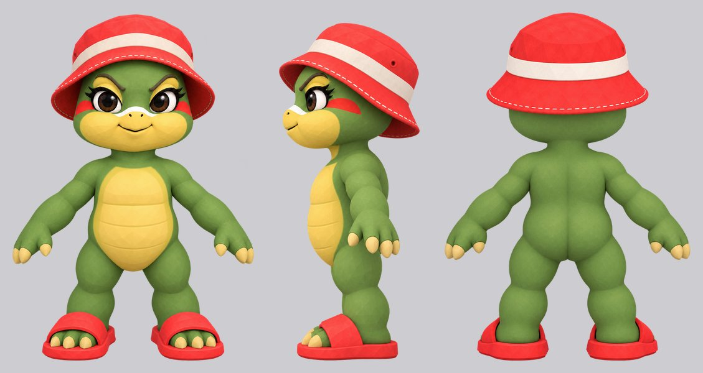
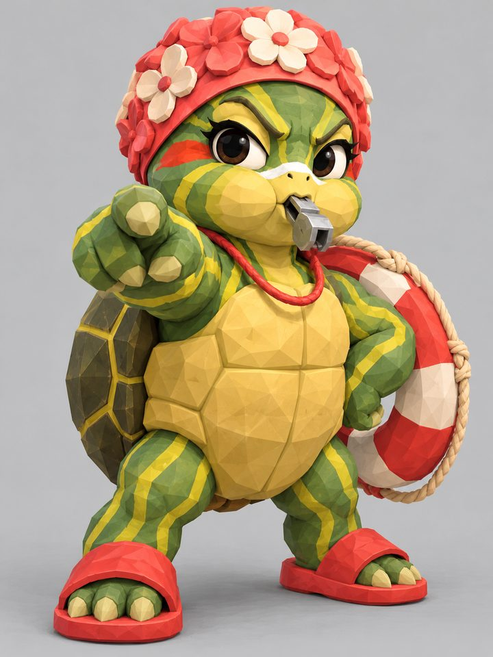
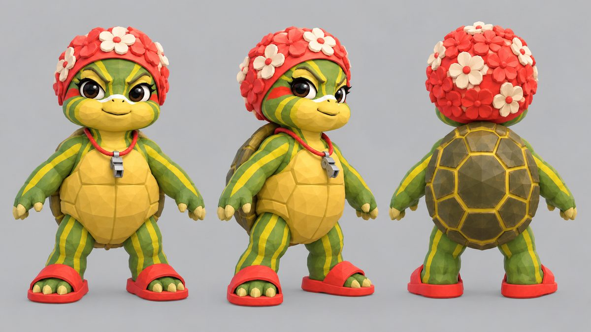
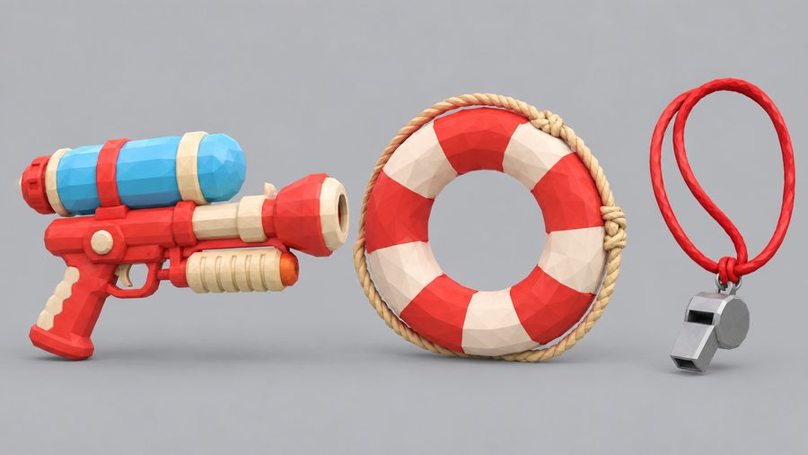
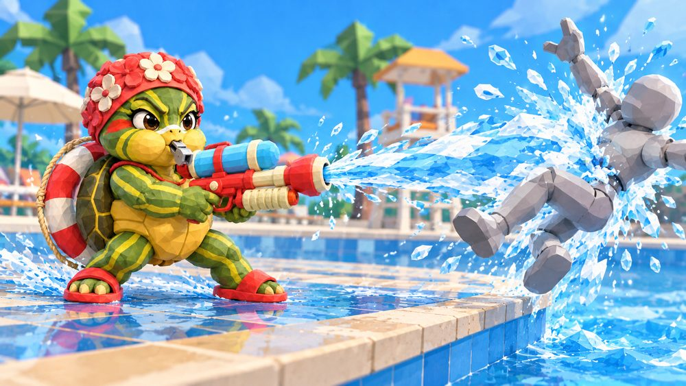
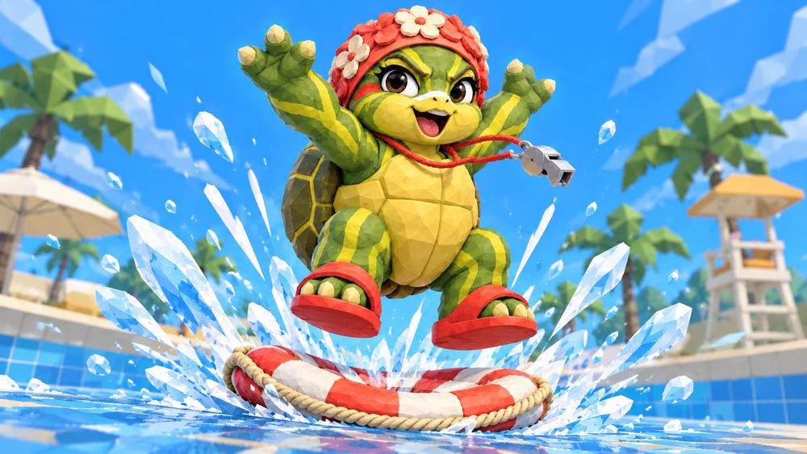
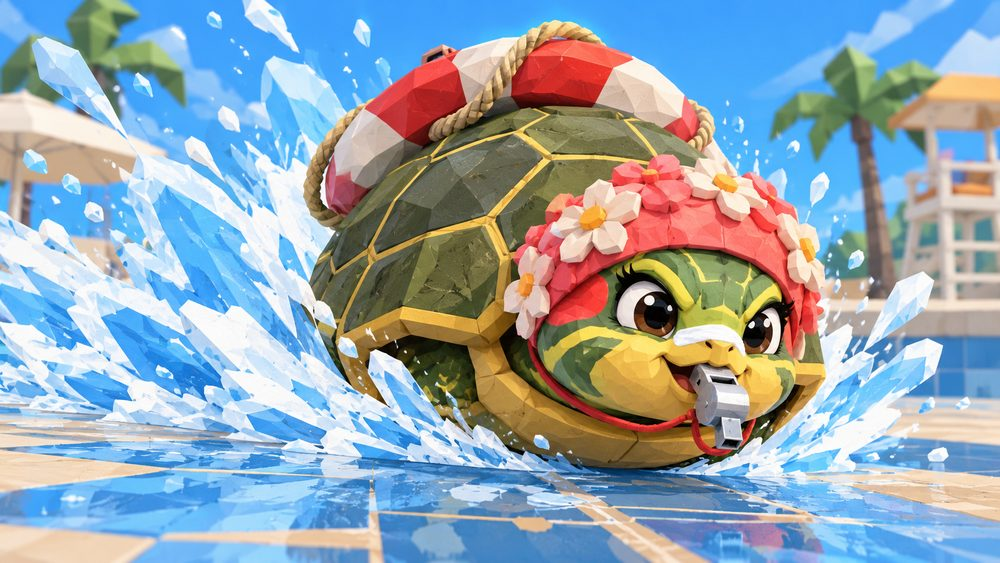
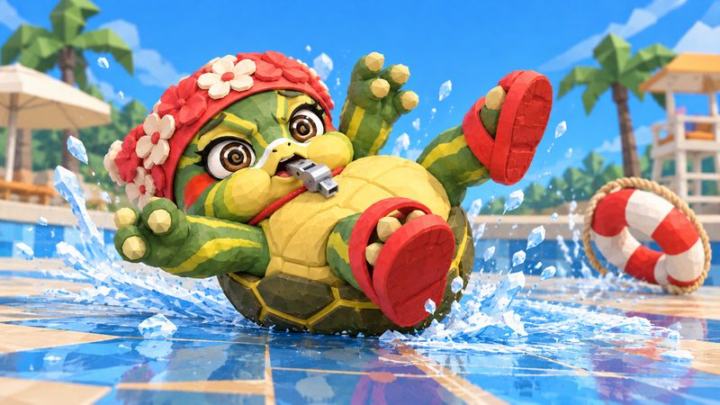
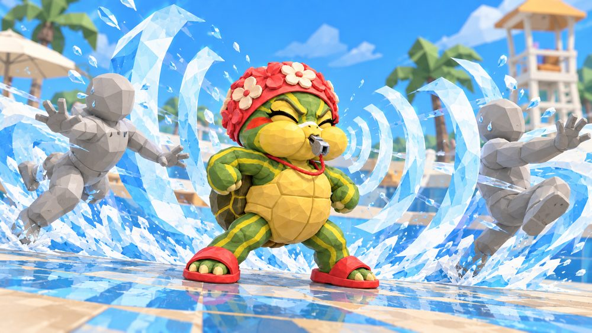

# Bashie

> **Three normals (2026-10-26, [ADR-0042](../adr/0042-controller-layout-three-normals-homing-dash.md)):** Whirlpool Spin and Air Whirlpool Spin, formerly normal 2, are now normal 1; Slap and Air Kick are retired. Normal-2 rows below are history.

> **Identity (owner, 2026-10-21):** a pool lifeguard turtle who can "look cute and be fun". She wants
> everyone to follow the pool rules, blows her whistle at all of them, and breaks every rule herself.
> She is the fifth fighter and the roster's first woman.

## Status

Playable with a stand-in kit. On 2026-10-21 the owner approved the look (concept A below, redesigned the same day),
the four specials and the name Bashie (Shelly was "a bit common"). On 2026-10-22 she got her package and joined the
roster, playing Manki's kit until hers exists. The same day her first special, Hose Down (A), went in (below), with its
own capability, her water blaster and key-pose animation, and then her Shell Slide (R), which tucks her into her own
shell, with her own clips, a surf wave and sounds, and Ring Bounce (E) supplied her aimed recovery. On 2026-10-28 the
owner replaced both with the shell kit ([ADR-0045](../adr/0045-bashie-shell-state.md)): Shell Shift and Shell Dive on R
and Hydro Jet on E share one shell state, built as a Training prototype. Ground and air 1
now have Whirlpool Spin after ADR-0042. Ground 4 has Rising Shell and air 4 its diagonal shell strike. Ground and air 3
have Shell Flip. Rescue Ring replaced Hose Down on A the same day
([ADR-0048](../adr/0048-bashie-rescue-ring-tether.md)), also a Training prototype. On 2026-10-29 the Cannonball (R) and
Wave Pool (F) replaced Shell Shift and NO RUNNING! ([ADR-0050](../adr/0050-bashie-cannonball-and-wave-pool.md)), also
a Training prototype. The owner's Training verdict the same day was GOOD for the Rescue Ring, the Cannonball, Wave
Pool and her walk. Her movement still comes from Manki.

**Package (owner, 2026-10-22):** "im totally down to steal all of manki's slots especially normals just to have her
ingame. its fine if specials looks weird until we do them properly".
- `client/Unity/Assets/CharacterPackages/bashie/` is a trusted built-in package (`CharacterClass.Bashie`, number 6:
  5 was the retired Nilus).
- Her movement still comes from Manki. Her
  own changes are the size (`visualScale` 1.1), `modelYOffset` -0.75, `hipHeight` 0.34, her idle and run, Rescue Ring in
  place of his Round Bomb, the Cannonball and its dive in place of his Bazooka, Hydro Jet in place of his Jetpack Boost, and Whirlpool
  Spin on ground and air 1, the diagonal shell strikes on ground and air 4, Shell Flip on ground and air 3, and Wave Pool on F.
- The remaining stand-in clips are copies of Manki's under `Animations/Borrowed/`, raised 0.342 m for her body.
  Played on her as they are, his clips stand her a third of a metre under the floor.
- She borrows none of his effects or props: her hits use the shared impact effects, and her specials fire without
  their models, explosions or trails.
- This deliberately breaks the [no-fallback rule](adding-a-new-character.md#2-validate-and-bind-assets) for the remaining
  stand-ins. Ground 1's accepted Slap replaces its borrowed move, with its own clip and cooked hand hitbox.
- Her roster portrait is `Resources/UI/Portraits/Bashie.png`.

The same day the owner generated a first 3D model, rigged it with Mixamo, and generated the water blaster and the
life ring. [tools/blender/bashie_rig](../../tools/blender/bashie_rig/README.md) removes the backdrop card the
generator left behind her and keeps 4 influences. A shell that bent with her back looked weird, and a shell cut off
that model as a solid piece on her mid-back bone still looked wrong.

On 2026-10-22 the owner generated her redesigned body (the look below) and rigged it with Mixamo. They also generated
her shell and her whistle as separate models. The rig build hangs the shell on her mid-back bone and the whistle, on
a red cord, on her chest bone, so none of them bend. She is a local Unity candidate (`BashieRig.prefab`, no package
yet). The files are local.

**Size (owner, 2026-10-21):** "a little bit smaller than Manki". Previews render the redesigned model at scale 1.10
against Manki's `visualScale` (the first model needed 1.15):
- standing on Manki's idle, she is about 1.05 m tall against his 1.16 m
- at rest, the top of her hat is 1.10 m against his 1.16 m

In-game previews run Manki's fighter with her model, so she uses his moves and animations until she has her own.

**Idle and run (owner, 2026-10-22):** picked from generated direction sheets, then authored with the
[GenRA workflow](genra-animation-workflow.md); the owner approved the key poses before the motion:
- Idle, "on duty": a 2 s loop scanning the pool under a visor hand, a fist on her hip and a toe tap. Her arms are too
  short to reach the front of her brim, so the visor salutes at its side.
- Run, "I'm not running!": she enforces NO RUNNING, so she speed-walks: two steps in 26 ticks, straight legs landing on
  the heel, a foot always on the floor, big hips and pumping elbows that stay in front of her shell. The first key
  poses folded her slides and goose-stepped; her slides now bend at most 15 degrees and her steps are 0.23 m.

Both are bound in her package (`Animations/bashie_idle.anim` and `bashie_run.anim`).

## Why a turtle

The roster had no woman.
- **Round 1, rejected:** everyday people (a roller-derby jammer, a luchadora, a landlady and a lunch lady). The
  owner said they "feel like real people". The roster's strongest designs are the least human: Manki is a monkey
  and Sir Bonk's face is a bucket.
- **Round 2, the possum:** came close but was dropped. Babies riding on her back would be costly to animate, and a
  tail hang has no use on our stages, where [ledge hang is off](../../CONTEXT.md).
- **Round 3, the turtle:** the owner proposed one inspired by Squirtle, built around a shell slide. Of three takes,
  the lifeguard won: her whistle gives her a running gag with every other fighter.

Squirtle inspired the moves, not the look: she has no blue skin, no curly tail and no brown shell. She is a
red-eared slider, the common pet turtle, which is named for sliding off logs into the water.

## Look

**Redesign (owner, 2026-10-21):** her bold stripes were "not really good looking" and her flower swim cap looked "a
bit weird". She now has plain green skin and a lifeguard bucket hat. Sunglasses were tried and dropped: over her
eyes they hide her big eyes, and Wibou already wears sunglasses.

- **Body:** small and round, with a big head, big brown eyes with lashes, stern brows and chubby cheeks. No tail:
  the generator gave her one, and the owner had it removed (2026-10-22).
- **Skin:** plain green with a yellow lower face, plus the slider's red patch behind each eye, which reads as blush.
- **Kit:**
  - a red lifeguard bucket hat with a white band and white stitching around the brim
  - a stripe of white zinc sunscreen across her snout
  - a silver whistle, a separate prop
  - red pool slides ("sliders" for a slider)
- **Shell:** domed and olive with yellow seams, and a yellow belly painted on her front. The bucket hat and the shell
  make her outline.

Concept A, its turnaround and the specials below came before the redesign. They still show the flower cap, the
stripes and the whistle on its cord:

Palette, sampled from the body sheet (the shell from the turnaround):

| Part | Colour |
| --- | --- |
| Hat | `#FC4E4A` |
| Hat band | `#F9E8D9` |
| Skin | `#86A552` |
| Face | `#FCD45E` |
| Belly | `#FCDC72` |
| Shell | `#534926` |
| Zinc | `#FDFDFC` |

For the 3D model:
- **Separate models:** the shell, the water blaster, the life ring and the whistle, like Sir Bonk's plank. The shell
  sits on her mid-back bone and the whistle on her chest bone, so a move can take the whistle to her beak for NO
  RUNNING!. The ring rides on her shoulder and the blaster comes out of her shell.
- **Solid pieces:** the shell and the hat are solid and chunky, which suits a generated mesh.
- **Thin pieces:** the ring's rope is thin: thicken it or paint it on. The rig build makes the whistle's cord.
- **Next:** her own idle and run, then the [new-character workflow](adding-a-new-character.md). The images her model
  came from are local, in `tmp/bashie-model/gen-inputs-v4/`.

## Kit

### Slap (ground 1)

The owner accepted the actual-rig full motion on 2026-10-23 with "good". She delivers one right open-palm slap,
follows through, and returns to idle without a scold gesture.

- The approved clock is 30 ticks at 60 Hz, with contact at tick 9, active ticks 9 through 11, and IASA at tick 22.
- A sphere of radius 0.5 m is centered on `bone.right-hand`, with all three local offsets zero. Damage stays at 4%,
  angle at 8 degrees, base knockback at 4, growth at 20, and stun at 14 ticks.
  Startup aim and other parameters are unchanged.
- The accepted full-motion native clip is bound from `Animations/bashie_g1_defined_slap.anim` under `anim.bashie.g1`.
  Its source is `Assets/Generated/AnimationCandidates/bashie_g1_defined_slap_motion_r1.anim`. The candidate report is
  `artifacts/bashie-g1-defined-slap-motion-20261023-r1/verification.json`.
- Verification passed 48 focused normal/reliability checks, native cook/verify and exact roster refresh. The authoritative
  Lab confirms one 4% hit at tick 9, a shield contact for zero damage, and no contact at 3 m, all returning to idle.
  An inspected Play Mode capture on Splash Deck shows the slap and recovery with one 4% contact at tick 9 and no errors.
  Playback is 1x; all three active ticks touch at 1 m, with no missed bone sampling. Forward reach is 1.15 m against
  FightGuy and 1.05 m against Manki, 0.2 m shorter than the borrowed foot move. Air 1 is unchanged.
  Normal Training menu entry and grounded 1 activation/recovery also passed with an empty console.
  Evidence is in `artifacts/bashie-g1-defined-slap-motion-20261023-r1/integration/`. Human controller feel remains on
  `TESTING-UNITY.md`.

### Whirlpool Spin (ground and air 2)

**Integrated 2026-10-22**, after the owner approved the actual-rig key poses, motion and in-game integration.
She tucks into her own shell with her face and bucket hat peeking out, spins once in place, then pops back up.
The image concept's elaborate seated pose was dropped in favour of the existing shell tuck.

- **Clock:** 40 ticks at 60 Hz. Tuck through tick 10, one turn from 10 to 30, then pop out; actionable at tick 36.
- **Hit:** one sphere around her, radius 0.85 m, active ticks 10–29. It deals 7% once per opponent with the existing
  medium knockback (25°, base 5, growth 26). No armour or special movement.
- **Animation:** `anim.bashie.g2`, bound to `Animations/bashie_g2_shell_spin.anim`, authored with GenRA/Opus 5.5
  on her actual rig. `anim.bashie.a2` reuses the approved clip and shell/water cues.
- **Air 2:** same clock and single hit; preserves takeoff momentum and uses the normal aerial gravity rules.
  Landing lag is 9 ticks, with auto-cancel through tick 10 and from tick 36. No recovery impulse or extra jump.
- **Presentation:** the package's `shell.spin-tuck` cue follows the attack clock, including Hitstop, and preserves
  the clip's heading while fully tucked. `shell.spin-water` adds a compact blue splash ring and the existing soft
  shell/water sounds. Cues end with the attack. Shell Slide keeps its existing tuck behaviour.
- **Verification:** Shared hits once from eight directions; shield and whiff recovery pass. Ability Lab records
  one 7% hit, one blocked contact or a miss at 3 m. Play Mode captures show the turn and return to standing.

### Shell Flip (ground 3)

The owner accepted the existing native poses and backward somersault on 2026-10-23, including a short cosmetic
forward and upward reach around contact. The head and red hat stay visible while she tucks into her shell.

- The attack lasts 42 ticks at 60 Hz, plays at 1x, hits during ticks 24 through 29, and becomes ready at 42.
- It deals 7% damage with base knockback 5, growth 26, Hitstun 18 and a 75-degree upward launch. Existing bounded
  startup aim correction remains. Slide carry is disabled. The simulated actor stays grounded and stationary.
- One root-relative capsule has radius 0.32 m, start offset `(0, -0.20, 0.65)` and end delta `(0, 0.60, -0.30)`.
  Its absolute end offset is `(0, 0.40, 0.35)`. It uses hit group 1, is interruptible, and has no bone anchor.
- `anim.bashie.g3` and `anim.bashie.a3` bind `Animations/bashie_g3_shell_flip.anim`.
- `presentation.bashie.shell.flip-tuck` starts at tick 4 for 38 ticks. The optional ShellTuck flip profile applies
  the accepted native hips rotation after the tuck during ticks 10 through 29. Its 43 lift samples carry the measured
  floor corrections. Runtime code reads no preview artifacts and scans no meshes.
- The visible reach peaks at 0.30 m forward and 0.25 m up in model space, or 0.33 m and 0.275 m at visual scale 1.1.
  Recovery retracts it. Shared owns contact, launch and timing.

The cooked-package checks passed all 17 G3 cases and 39 existing Bashie normal cases. Native Lab verifies one hit,
a blocked contact and a whiff. Play Mode captures use Bashie against Manki at 1 m and verify the hit, Shield, whiff,
Hitstop and cleanup after injected Hitstun at ticks 18 and 25. G2, G4 and air 3 reliability rows remain unchanged.
Evidence is in `artifacts/bashie-g3-integration-20261023-r1/implementation/cutover/`. The raw hierarchy probe used an
incorrect scaled mesh conversion. Its corrected report includes every skin and agrees with weighted bone skinning.
Sub-tick floor clearance and human controller feel remain unverified.

### Air Shell Flip (air 3)

Reuses the accepted G3 clip under `anim.bashie.a3`. She tucks into her shell and somersaults backward while
preserving airborne momentum and normal gravity. No velocity writes, gravity windows or air-resource resets apply.

- **Clock:** 42 ticks at 60 Hz, actionable at tick 42. Startup aim correction runs through tick 9.
- **Hit:** the same root-relative capsule as ground 3, active ticks 24 through 29. It hits each opponent once for
  7% at 75 degrees, with base knockback 5, growth 26 and Hitstun 18. Slide carry is disabled.
- **Landing:** 9 ticks of landing lag, auto-cancel before tick 10 and from tick 36. Landing and interruption clear
  the hitbox and tuck through the existing ability and presentation lifetime.
- **Presentation:** `presentation.bashie.shell.flip-tuck` starts at tick 4 for 38 ticks on `bone.hips`.
  The shared cue holds both G3 and A3. There is no water cue.
- **Verification:** source-compiled Shared tests cover four facings, momentum and fall equivalence, landing windows,
  grounded Shield, a 3 m whiff and interruption. Unity rebuild, cook, roster refresh and visual verification remain pending.

### Rising Shell (ground 4)

A short diagonal shell strike that pulls back to its starting spot. She makes a real hop (about 0.55 m); her tucked
body reaches forward (up to 0.66 m at visual scale 1.1), then retracts as she lands. The gameplay root keeps its X/Z
position, and input cannot steer the hop.

- **Clock:** 48 ticks: 14 wind-up, 10 strike, 24 recovery. The fixed hop leaves the floor during the last part of
  the tuck and lands by tick 29; she stays committed until tick 48. No early cancel, slide carry or forward lunge.
- **Hit:** root-relative spheres follow the real hop and forward shell reach each tick from 14–23, radius 0.65 m.
  Their forward offset is 0.2 m plus the shell reach. They share hit group 1, so the move deals 14% once per opponent;
  angle 45°, base knockback 9, growth 42, stun 26.
  This stays in Shared rather than reading Unity bones or animation callbacks.
- **Motion:** `anim.bashie.g4` uses the accepted bare native clip, `Animations/bashie_g4_rising_shell.anim`.
  Shared timeline velocity samples own the short vertical arc, with gravity suppressed only during that arc.
  The `shell.rise-tuck` cue folds the body and drives its forward reach on the attack clock (10=0,16=0.6,22=0.4,
  28=0 model metres). Emerge by 32, settle to idle by 48. Hitstop freezes the hop and reach;
  interruption clears the hitboxes and tuck. Ordinary movement, jump, dodge and fast-fall inputs cannot steer
  or cancel it. The hop belongs only to ground 4; air 4 remains separate.
- **Effects:** reuses the existing shell plop, water ring, shell-hit splash and soft water/shell sounds.
- **Verification:** focused Shared tests cover one hit, shield, whiff, an airborne target, interruption and resisted
  steering/jump-cancel inputs. Normal Training records a real airborne hop, unchanged X/Z and return to the original
  floor height; live captures show hit, block and miss with no console errors.

### Air Diagonal Shell (air 4)

Reuses the accepted G4 clip under `anim.bashie.a4`. The tucked body reaches diagonally forward and up, then
retracts and unfolds into falling. Her gameplay root preserves airborne momentum and follows normal gravity:
there are no velocity writes, gravity windows, recovery impulses or air-resource resets.

- **Clock/hit:** 48 ticks, active 14–23, one 14% hit per opponent at 45° (base 9, growth 42, stun 26).
  The Shared hitboxes follow the same forward reach as G4 plus a local upward reach (5/6 of forward, up to
  0.55 m in game). These offsets do not move the fighter's gameplay position.
- **Landing:** 12 ticks of landing lag, auto-cancel through tick 10 and from tick 36. Landing/interruption
  clears the strike and tuck through the existing ability/presentation lifetime.
- **Presentation:** `shell.air-strike-tuck` applies the accepted fold/reach with an upward component, using the
  attack clock so Hitstop pauses it. Existing water ring and shell-hit splash; no grounded plop cue.
- **Verification:** aerial contacts in all four cardinal facings, momentum/fall equivalence to baseline, shield,
  whiff, landing windows and interruption pass. Runtime captures show an airborne hit and clean falling/landing;
  the native Training probe records air 4 activation and return to grounded idle, with no console errors.

### Specials

Each special uses one thing she carries, and each one pops up a pool-rule sign that she is breaking. The whistle is
the one rule she enforces, on everyone else.

| Slot | Special | Shape | The opening |
| --- | --- | --- | --- |
| A | Rescue Ring | She throws her life ring straight at her target. The first fighter it meets is reeled in to her feet, stuck just long enough for one normal. It works in the air, and from the shell she pops out to throw. | A miss (range, a wall, a shield) leaves her reeling the empty ring back. Hit her or the caught fighter and the line drops. |
| E | Hydro Jet | She tucks and jets off in the stick's direction with no wind-up (neutral goes straight up). The jet behind her shoves. R mid-jet dives without untucking; a jet that meets the ground splashes. | No armour: any hit pops her out. The jet's direction is fixed once it starts. |
| R | Cannonball / Cannonball Dive | On the ground she hops up tucked and cannonballs onto where her target stood. In the air she dives steeply at the ground ahead, leaning toward a target in front. Either landing splashes everyone around upward, into her normals. | A target that moved is missed and she pops up out of the splash, open to a punish. |
| F | Wave Pool | A short whistle, then she rides a wave in her shell toward her target, carrying everyone it meets toward the edge, shields and all. The wave breaks at the lip. Jumping off sends them on at her speed into her aerial. | The whistle is the tell. Any hit on her ends the ride and lets everyone go. |

### Rescue Ring (A)

**Accepted 2026-10-28** for a Training prototype ([ADR-0048](../adr/0048-bashie-rescue-ring-tether.md)): the owner chose
it over Hose Down. Ground A and its air alias start one public `slop.ability.tether.v1`
([ability architecture](../systems/ability-architecture.md), [combat](../systems/combat-systems.md#tether)). First-pass
values, open to play:

- **Throw:** at tick 10 the ring flies straight at her current target's torso, 24 m/s for 20 ticks (8 m), radius
  0.45 m. With no fighter in the 20 m lock range it flies level along her facing. It never homes.
- **Catch:** the first fighter it meets takes 2% and is reeled to 0.9 m in front of her feet at 16 m/s on each axis,
  over a ledge lip if it was below one. Air dodge invincibility lets the ring pass.
- **Arrival:** the caught fighter stays stuck for 13 ticks and she is free on the next tick. Measured on her package:
  ground 1 started then lands 10 ticks after the arrival; ground 4 (14) and ground 3 (24) meet a held shield. The
  first pass of 22 ticks let ground 4 land as well.
- **Miss:** the empty ring reels back at 16 m/s, then 12 ticks of recovery. A full-range miss locks her about 72
  ticks. A wall head-on or 45 ticks of reeling snaps the line.
- **Cooldown:** 150 ticks.
- **Presentation (stand-ins):** the old Ring Bounce clip throws (`anim.bashie.ring`), the pump clip reels and the
  spray clip retracts. Her life ring prop flies as the projectile and sits on the caught fighter's hips. A rope runs
  from her right hand ([`TetherRopePresenter`](../../client/Unity/Assets/Scripts/Runtime/Combat/TetherRopePresenter.cs)).
  The caught fighter holds a small-hit pose. Capture: `tmp/bashie-ring/ingame/rescue-ring-training.mp4`.
- **Verdict:** GOOD in Training on 2026-10-29, catch and punish included.
- **Open:** real clips, effects and sounds. The CPU sees only the throw.

### Hose Down (A, retired 2026-10-28)

Built 2026-10-22 on the public `slop.ability.charged-stream.v1`: hold to pump the water blaster, release to spray a
stream that pushed without hurting (FLUDD, the owner's reference). Rescue Ring replaced it. The capability stays
public and keeps its coverage through FightGuy's fixture in `ChargedStreamTests`. Its blaster, clips and NO SPLASHING!
cues stay in the package, unbound from her A.

### The shell: Cannonball, Wave Pool and Hydro Jet (R, F and E)

**Accepted 2026-10-29** for a Training prototype ([ADR-0050](../adr/0050-bashie-cannonball-and-wave-pool.md)): Shell
Shift "just goes in a direction and feels useless and hard to hit" and NO RUNNING! "feels out of place", so the shell
now does two things, a splash and a ride ("this sounds very cool. lets go for it").

- **Splash.** Every tucked landing splashes: R, air R and a Hydro Jet that meets the ground end there, R's cooldown
  starts, and a wide hitbox at her feet launches everyone around upward. She pops up in place, hit or miss.
- **R, ground: Cannonball.** She takes her current target on her first tick (else 4 m along her facing), squats and
  hops on one solved arc onto where they stood. A hit in flight ends it with no splash. With no landing by the stage end
  she untucks and falls free. Q, then R on her first free tick, splashes inside the ring's arrival window.
- **R, air: Cannonball Dive.** The thrust dive, unchanged; its landing splashes. Pressed during Hydro Jet it keeps the
  jet's speed.
- **F: Wave Pool.** The whistle turns her toward her target and hangs her in the air; when it ends she rides her wave
  (`ActionState.Shell`) toward her target's ground point, turning toward it at a capped rate. The wave catches each
  fighter once (small damage, credited to her) into `ActionState.Swept` and carries them at her speed, through shields.
  The ride ends on its clock, at the lip (she stops on it, they fly on), at a head-on wall (she bounces back), on a hit
  or on any action; carried fighters are let go with her speed. Air F coasts until she lands, then the clock starts.
- **First-pass values (named, untuned):** splash sphere 1.7 m at her feet, damage 9, angle 85, knockback 10 + 25, stun
  24, 3 ticks, pop-up 18 ticks. Cannonball takeoff tick 2, max range 8 m, flight 5 to 40 ticks by distance, launch cap
  20 m/s, 70-tick stage, cooldown 150 (shared with the dive). Dive: -55°, 14 m/s accelerating 30 m/s² to 24 for up to
  45 ticks, IASA 24, 60° cone. Ride 90 ticks at 13 m/s, turn 40°/s, wave capsule 2.2 m wide 0.8 m ahead (radius 0.7,
  damage 3 once). Whistle 24 ticks, blow at 18, gravity 0.15, cooldown 540. Hydro Jet: 15 m/s for 20 ticks, stick
  pitch 25°, IASA 8, trailing shove, cooldown 210. Pop-out braking 40 m/s², wall bounce 4 m/s.
- **Stand-in presentation:** the tuck cue holds while she is in the shell (`ShellTuck.HoldWhileTucked`; Wave Pool's
  cue waits out the whistle); the shell pose is `anim.bashie.gr-slide`; the plop is the splash; the surf wave, grown
  2.2 times, shows while she rides; carried fighters hold the small-hit pose like Reeled ones; `WhistlePuff` paces the
  accepted puff to the blow cue. No new art, VFX or sounds yet.
- **Verdict:** GOOD in Training on 2026-10-29: R, jump then R, Hydro Jet then R, the wave into an aerial, and Q then
  R as the ring delivers.
- **Open:** real clips, effects and sounds, and the untested mode cases (the Slopball ball, Mayhem walls, course
  targets, a reset mid-ride).

### Shell Shift and the skate (R, retired 2026-10-29)

Built 2026-10-28 ([ADR-0045](../adr/0045-bashie-shell-state.md)): ground R tucked her into a 90-tick skate at her run
speed that bowled fighters once, Shell Dive's landing and Hydro Jet's coast fed the skate, and a shield popped her up.
ADR-0050 deleted the skate, the bowl and the walk-off coast; `anim.bashie.gr-pop` stays listed on the Cannonball's
stage but is not played.

### Ring Bounce (E, retired 2026-10-28)

Built 2026-10-22 on the public `slop.ability.aimed-recovery.v1`: she threw the life ring, hopped onto it, squashed it and
sprang 15 m/s up (stick aimed: 13 up, 8 across) at tick 44 of a 54-tick move, cooldown 210. Hydro Jet replaced it; its
clip `bashie_e_ring_bounce.anim`, ring props and cues stay in the package, unbound from her E. The capability keeps its
tests through a fixture. Plans: [integration](../plans/2026-10-22-bashie-ring-bounce.md),
[four-beat revision](../plans/2026-10-22-bashie-ring-bounce-v2.md).

### Shell Slide (R, retired 2026-10-28)

Built 2026-10-22 on Sir Bonk's `slop.ability.steered-charge.v1`: a steered, armoured 13 m/s slide for up to 240 ticks
that ended on the first hit, with a flipped-on-her-back miss and a thin-air look-down. Shell Shift and Shell Dive
replaced it. What carries over: the tuck (`ShellTuck`/`ShellTuckRig`, look "A", her hat and face peeking out), its clips
(`anim.bashie.gr` dive, `gr-slide` loop, `gr-pop` pop-out; `gr-flip` and `gr-lookdown` are unbound), the plop and
hit cues, and the surf wave, which Wave Pool now rides.

### NO RUNNING! (F, retired 2026-10-29)

Built 2026-10-26 ([specification](../plans/2026-10-26-bashie-no-running.md)): a 48-tick inhale, then a blow that
stunned everyone within 5 m for 120 ticks with no damage or slide; Shields blocked it. Wave Pool replaced it. What
carries over: the owner's swell C (`WhistlePuff`, `WhistlePuffRig`, the baked `Puff` blend shape built by
`sloparena.presentation.bashie.puff.build`), the whistle prop, the floor-ring blow, the inhale, trill and deflation
sounds and `anim.bashie.whistle`. The NO RUNNING! sign is unbound and no longer built; its texture and prefab stay in
the package. Its captures remain in `tmp/bashie-f/`.

## Engine pieces

| Special | What exists | What's new |
| --- | --- | --- |
| R | The shell ([ADR-0050](../adr/0050-bashie-cannonball-and-wave-pool.md)): `ActionState.Shell`, `slop.ability.shell-stance.v2` (splash and ride), `slop.ability.cannonball.v1` and `slop.ability.thrust.v1` ([ability architecture](../systems/ability-architecture.md)). | Built 2026-10-29 as a Training prototype; Shell Shift and the skate retired. |
| A | Grab pairs (`InteractionId`, `InteractionPartnerId`), projectiles, auto-target projectile aim and the body mover. | Built 2026-10-28: `slop.ability.tether.v1` and `ActionState.Reeled` ([ADR-0048](../adr/0048-bashie-rescue-ring-tether.md)); Hose Down's charged stream retired from her kit. |
| E | `slop.ability.thrust.v1` with a trailing hitbox, a tuck move like R. | Built 2026-10-28 with the shell; Ring Bounce (aimed recovery) retired. |
| F | No capability: the slot's `shellPolicy: ride` starts the shell's ride when the whistle completes; its wave carries fighters as `ActionState.Swept`. | Built 2026-10-29; NO RUNNING!'s stun retired. |

## Concept images

The images in [`docs/design/references/bashie/`](../design/references/bashie/) were generated with an OpenAI image
model on 2026-10-21. Concept A came from a prompt and the others were made from concept A, except the body sheet,
which came from the redesign. They are design references, not game art.
