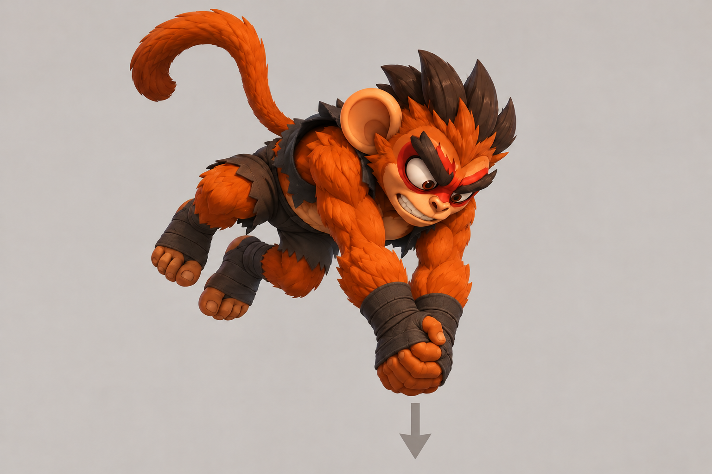
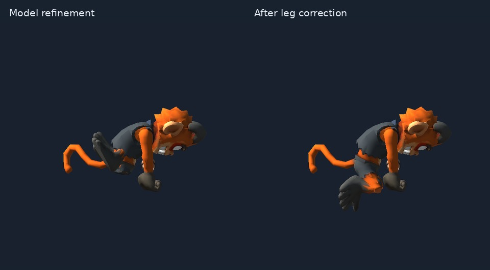

# Trying GenRA for cartoon combat animation in SLOPArena

*Early field report · 14 October 2026*

*Prepared by Codex from the experiment artifacts and session records. The project owner supplied creative direction and reviewed the results.*

SLOPArena is a 3D platform fighter aiming for exaggerated, readable cartoon moves. Animation authoring has been a bottleneck in its agent-assisted development workflow.

These initial experiments combined [MacPaw’s GenRA](https://github.com/MacPaw/GenRA), Codex and the project’s existing Blender/Unity tools. A grounded punch on FightGuy was followed by a new aerial double-fist strike for Manki. This page focuses on Manki.

**Watch the corrected result at normal speed:** [side view, MP4](media/genra/manki-aerial-side.mp4) · [gameplay-like angle, MP4](media/genra/manki-aerial-gameplay.mp4).

The clips show a standalone preview on the actual character prefab. The game supplies the jump/fall trajectory; the animation adds no root travel. The candidate is imported separately and still awaits gameplay/contact acceptance.

The image below was the concept guide. Manki’s mesh, skin weights and rig already existed; this experiment authored the motion.

**Inputs**

- Manki’s actual 66-bone rig and ten meshes, with the hierarchy and bind pose preserved.
- Two explicit same-rig motion references: the existing jump and fall clips, for airborne posture and transitions. The attack itself was a new gesture.
- A description of the overhead load, simultaneous downward strike, follow-through and recovery.
- The real timing of an existing authored move, plus fixed entry/handoff poses and frozen joint translations/scales.
- `auto_select_examples=False` throughout.

| Timing requirement | Value at 60 Hz |
| --- | ---: |
| Duration | 62 ticks / about 1.033 seconds |
| First impact | Tick 23 |
| Active interval | Ticks 23–30 inclusive |
| Actionable recovery / handoff | Tick 57 |

Before generation, an existing fall animation completed a round trip through Unity → the original rig → USD → Blender → FBX → Unity. The required fall control passed the experiment’s 1 mm skin-error check, at 0.480 mm maximum error. An auxiliary jump control remained slightly outside that threshold, at 1.074 mm; that discrepancy was recorded. The approved source clips stayed unchanged.

**How the result was made**

This was a **Codex-backed GenRA experiment with a custom provider adapter**, using an existing ChatGPT-authenticated Codex CLI login. GenRA supplied the rig/reference prompt structure, sparse animation representation, parser, interpolation and USD output. The adapter forwarded the context and images to Codex, allowed read-only numerical FK/IK calculations, and returned animation JSON to GenRA. Request descriptions and joint-name mapping were deterministic, avoiding auxiliary model jobs.

There was one generation job, followed by one focused refinement of the downward reach and leg tuck. The original response, sparse keys, refinement patch, merged data and USD output were preserved. The CLI jobs contain multiple internal model/calculation turns; “two jobs” is not a count of underlying inference requests.

The project owner liked the overall motion but identified the legs bending the wrong way during review. Codex then wrote a constrained repair using the rig’s real limb lengths and knee poles. It corrected six thigh/calf/foot joints, removed the sideways ankle roll and smoothed conflicting intermediate leg poses. That repair used deterministic kinematics after the code was written; there was no third GenRA generation/refinement job.

**The clips shared above include this scripted leg correction.** The upper-body motion, root, timing, entry and recovery were preserved. The heels now sit lower behind the strike, giving up the earlier fist/ankle height target to fix the anatomy.

**What worked well**

The experiment produced a new attack gesture from a working rig, an image and airborne references. The sparse keys made the output inspectable, allowing a bounded refinement and an exact comparison of changes. The final Unity candidate plays at 1×, with the requested clock and a fixed root.

The project’s [animation-authoring workflow](../../skills/sloparena-animation-authoring/SKILL.md) supplied the import and validation rules: preserve source assets, check the actual prefab, verify gameplay timing and inspect the motion from useful angles. The owner’s visual review caught a leg problem that the initial numeric checks missed.

**Potential improvements suggested by this experiment**

1. **A documented provider-adapter interface.** The custom adapter allowed GenRA to use the project’s existing Codex setup. A supported hook would make experiments with different providers easier to reproduce, including prompt/image forwarding and usage records.
2. **Rig-defined knee poles, joint limits and ankle-roll limits.** The model reached the requested silhouette target using an implausible leg solution. Artist-controlled constraints could preserve the intended bend direction while leaving room for cartoon exaggeration. IK/FK control targets are a possible next test; these runs used deformation-bone rotations.
3. **Explicit refinement scope and key replacement rules.** In the experiment’s custom patch merger, retained first-pass keys interrupted the refined tuck. A contract for joints, channels, time ranges, frozen endpoints and replacement of intermediate keys would help. This particular merge issue came from the custom adapter workflow.
4. **Portable validation examples.** Bone-path maps, units/axes, exact frame counts, root policy and pose comparisons would make downstream integration easier. Real Animancer playback needed checking alongside clip sampling: root extraction behaved differently. Manki’s fingers/tail also needed explicit curves beyond the 22 bones mapped by its Humanoid Avatar. These findings came from the project’s Unity pipeline.

For reproduction, this run used GenRA at [commit `5f4ffb8`](https://github.com/MacPaw/GenRA/tree/5f4ffb8ac846f91265c48e8bb65d702dca11b7a1), Python 3.12.13, Blender 5.2.2 and Unity 6000.0.78f1. The recorded model ID was `gpt-6.1-sol`, with medium reasoning effort. Each model job had a 600-second bound and no transport retries. Generation took 354 seconds and refinement 211 seconds; these are model-job timings, not total authoring time. The [experiment summary](media/genra/experiment-summary.json) records the settings and shared-media hashes.

